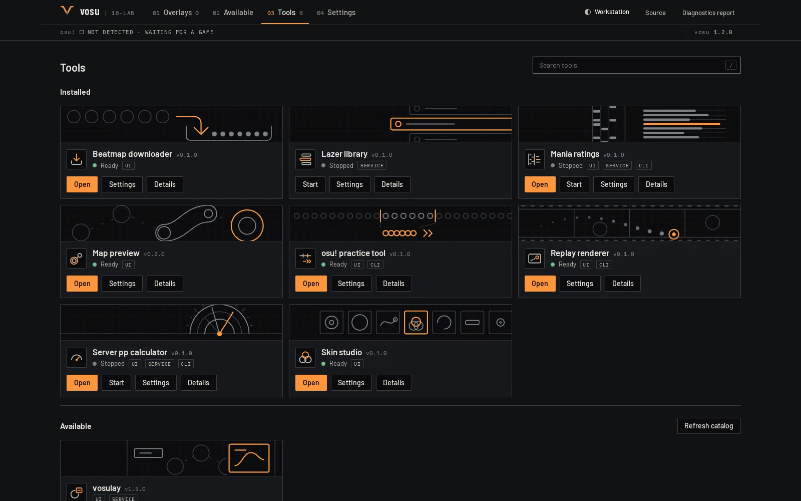
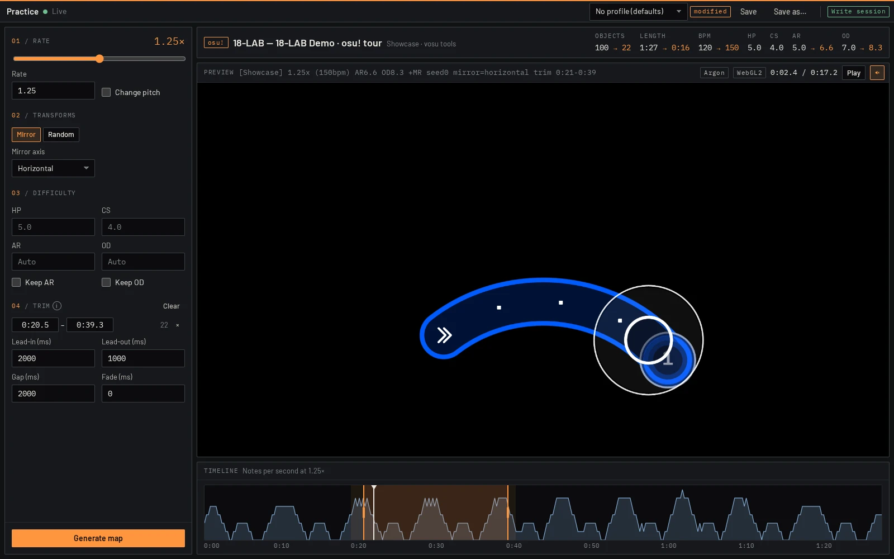
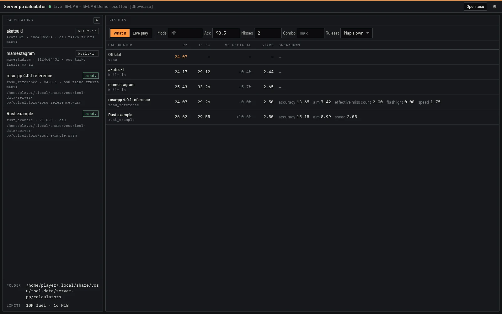
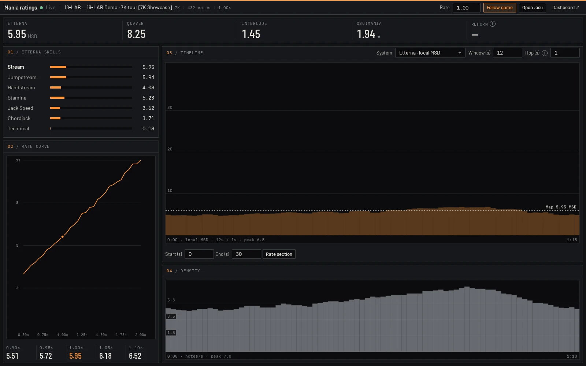
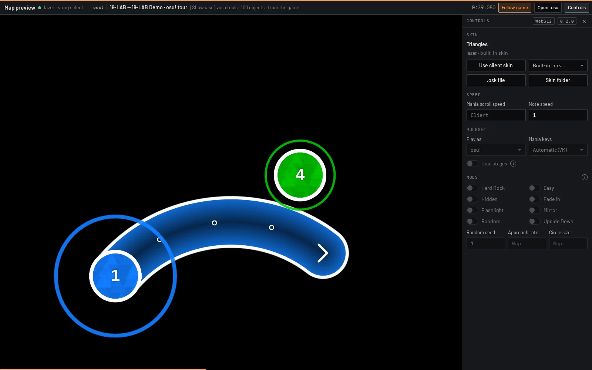
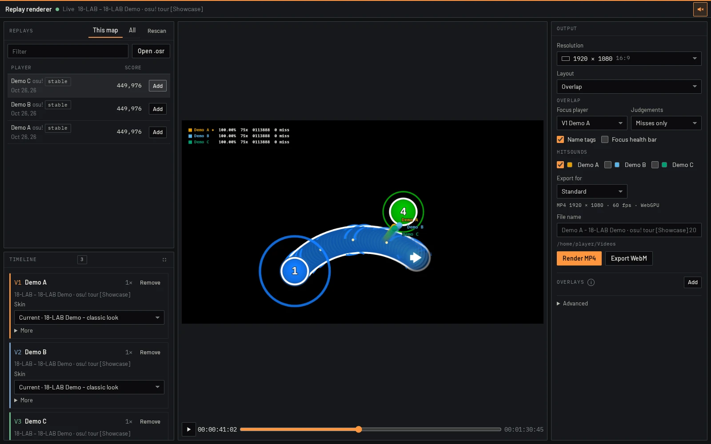
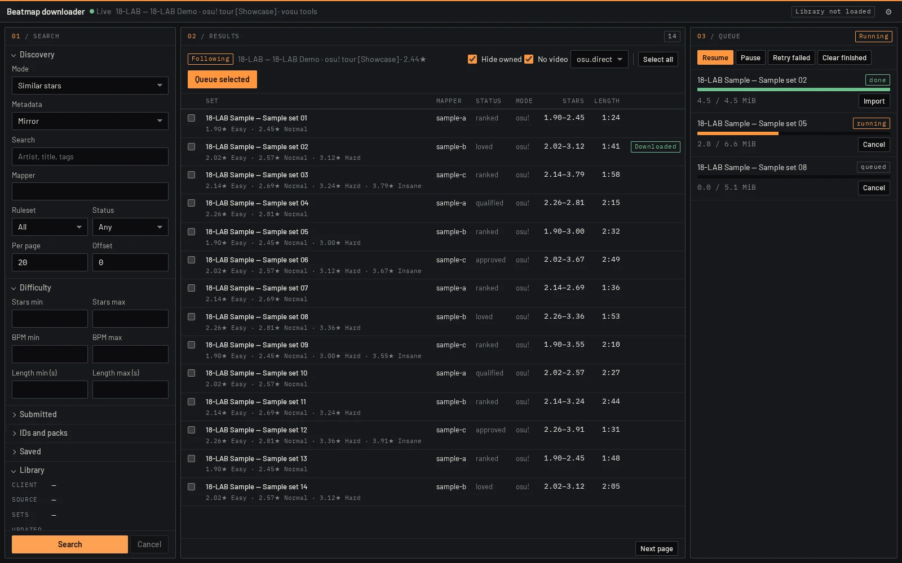

# vosu tools

Official tools for [vosu](https://github.com/18-lab-dev/vosu) by 18-LAB. Install them from the vosu dashboard's **Tools** page. Each one opens in your browser with **Open**, and some also run in the background or on the command line (`vosux <id>`).



The pictures below are real tool pages, running in a vosu with no osu! client attached. Instead of a game, the maps, skins and replays in them are 18-LAB's own generated demo content. See [how they are made](docs/screenshots/README.md).

## osu! practice tool

Make practice copies of the map you have selected in osu!: change its rate, difficulty and ruleset transforms, trim it to the sections you want to grind, and preview the result before generating it.



*A generated demo map at 1.25× with Mirror and one kept section.*

[Details](tools/practice/README.md)

## Server pp calculator

See what the selected map is worth on recorded public Akatsuki and Mamestagram calculator snapshots, or on pp formulas of your own, next to official pp.



*A generated demo map with the two built-in profiles and two of the tool's example custom calculators.*

[Details](tools/server-pp/README.md)

## Map analysis

One selected-map dashboard for every ruleset: official stars and skills, accuracy-target pp and descriptive section timelines (ours), with the complete mania calculator views retained. Follows the played ruleset, mods and exact rate. The rosu-pp 4.0.1 algorithms match lazer 2025-10-13; newer lazer can differ.



*A generated 7K demo chart.*

[Details](tools/map-analysis/README.md)

## Skin studio

Browse your stable and lazer skins, preview their elements and gameplay in every ruleset, mix parts of several skins into a new one, and edit skin.ini with checks.


*The Keymodes tab: a 7K mix of skins exported from render-core's own drawings of the classic and Triangles looks.*

[Details](tools/skin-studio/README.md)

## Map preview

Watch the map selected in osu! play out in any of the four rulesets with your skin, mods and the game's clock, or preview any `.osu` file.



*A generated demo map drawn with the built-in Triangles look.*

[Details](tools/map-preview/README.md)

## Replay renderer

Turn replays into videos: put several replays side by side or overlap them on one playfield, pick skins and an output size, and render MP4 or WebM.



*Three generated replays of a demo map in the Overlap layout.*

[Details](tools/replay-renderer/README.md)

## Beatmap downloader

Find maps like the one you have selected (same mapper, similar stars or mania MSD, your recent play history) and download them from a mirror through a polite, validated queue.



*Sample data: synthetic search results and queue entries, not real maps.*

[Details](tools/downloader/README.md)

## Lazer library

A background service with no page of its own. It lets the other tools read your osu!lazer library (maps, skins and replays) without changing it.

[Details](tools/lazer-library/README.md)

## Interfaces

| Tool | id | UI | Service | CLI |
| --- | --- | --- | --- | --- |
| osu! practice tool | `practice` | yes | backend | `vosux practice` |
| Server pp calculator | `server-pp` | yes | background | `vosux server-pp` |
| Map analysis | `map-analysis` | yes | background | `vosux map-analysis` |
| Skin studio | `skin-studio` | yes | backend | — |
| Map preview | `map-preview` | yes | — | — |
| Replay renderer | `replay-renderer` | yes | backend | `vosux replay-renderer` |
| Beatmap downloader | `downloader` | yes | backend | — |
| Lazer library | `lazer-library` | — | background | — |

Each tool is an out-of-process application hosted by vosu (tool protocol v1). It can have a browser UI under `/tools/<id>/`, a supervised background service, and a command line run through `vosux <id>`. vosu installs them from this repository's releases through the dashboard's tool catalog.

UI/CLI tools can have a native **backend** for local files or rendering. vosu starts it on demand and stops it when idle; it is not a separate service interface. Only background services have Start/Stop/Restart and **Start with vosu** controls. That per-user setting overrides the manifest default and is available in Details, tool Settings, or `vosux --autostart <id> on|off|default`. Server pp, map analysis and lazer library default to on-demand; enable startup for whichever background services you use.

## Layout

- `crates/vosu-tool-sdk`: Rust helpers for the tool protocol (environment, readiness handshake, token checks, vosu/host/dependency clients, CLI output helpers).
- `crates/*`: shared Rust libraries.
- `packages/tool-web`: shared web tooling (bridge types, Vite preset). `packages/*`: shared browser libraries.
- `tools/<id>/`: one tool per directory: `Cargo.toml` (binary `vosu-<id>`), `tool.toml`, optional `settings.json`, optional `web/` (Vite project building to `web/dist`).
- `scripts/package.py`: builds release packages and `catalog.json` ([contract](docs/catalog.md)).

## Development

Requirements: the pinned Rust toolchain (`rust-toolchain.toml`), Bun, and a vosu 1.2.0 build.

```sh
bun install
bun run build                      # build every tool UI into web/dist
cargo build --locked
vosu --tool tools/<id>             # run a tool from this checkout; vosu restarts it after rebuilds
vosux <id> --help
```

Beatmap fixtures use LF on every checkout, including Windows (`.gitattributes`),
so golden comparisons and section-insertion tests do not depend on Git's
`core.autocrlf` setting.

## Release packaging

With Python 3.11+, the target's native build dependencies, Rust, and Bun installed:

```sh
bun install --frozen-lockfile
python scripts/package.py --target x86_64-unknown-linux-gnu \
  --base-url https://github.com/18-lab-dev/vosu-tools/releases/download/v0.4.0
python -m unittest discover -s scripts -p test_package.py
```

Packages and `catalog.json` are written to `dist/`. The script builds release binaries with the locked Cargo graph, builds offline UIs with hidden source maps for bundled-package license discovery, and emits verified, deterministic ZIPs. `--dry-run` validates manifests and prints the build plan; `--skip-build` packages existing binaries and hidden-sourcemap UI output. Windows releases use `x86_64-pc-windows-msvc`; the native Windows runner also checks Clippy and tests. Universal UI-only packages are published once from Linux (`--native-only` omits them on the Windows packaging job). Catalog merging and license provenance are described in the [package contract](docs/catalog.md#building-and-merging-catalogs).
Manifest, catalog, lockfile and source-map text, along with Cargo's captured
metadata, is decoded as UTF-8 regardless of the build machine's locale.

The reusable real-package smoke requires a separately built vosu `test-harness` binary and both generated catalogs:

```sh
python scripts/smoke_install.py --vosu /tmp/vosu-int-target/debug/vosu \
  --tools /tmp/vosu-tools-evidence/integration/packages/tools \
  --overlays /tmp/vosu-tools-evidence/integration/packages/overlays \
  --playwright-module /tmp/vosu-tools-evidence/catalog/browser/node_modules/playwright/index.mjs \
  --browser-cache /tmp/vosu-tools-evidence/catalog/browser-cache
```

It serves test-only loopback catalog copies (package digests/bytes are unchanged), isolates HOME and every XDG root including `XDG_RUNTIME_DIR`, uses only daemon ports 25150/25151, installs and approves the real tools, starts services, reads their APIs, exercises CLI help, and opens all UIs in a private headless browser. JSON receipts, logs, CLI help, and dark/light screenshots go under `/tmp/vosu-tools-evidence/integration/`. It never generates practice maps, modifies skins, downloads user beatmaps, or renders to a user's directories.

## Screenshots

The pictures in this README come from the packaged tools in an isolated, sandboxed vosu. `scripts/screenshots.mjs` regenerates them all; [docs/screenshots/README.md](docs/screenshots/README.md) lists what each one shows and how to run it.

## License

Project code is available under the MIT or Apache-2.0 license, at your option. Ported third-party code keeps its own license, recorded next to it and in [THIRD_PARTY_NOTICES.md](THIRD_PARTY_NOTICES.md).
