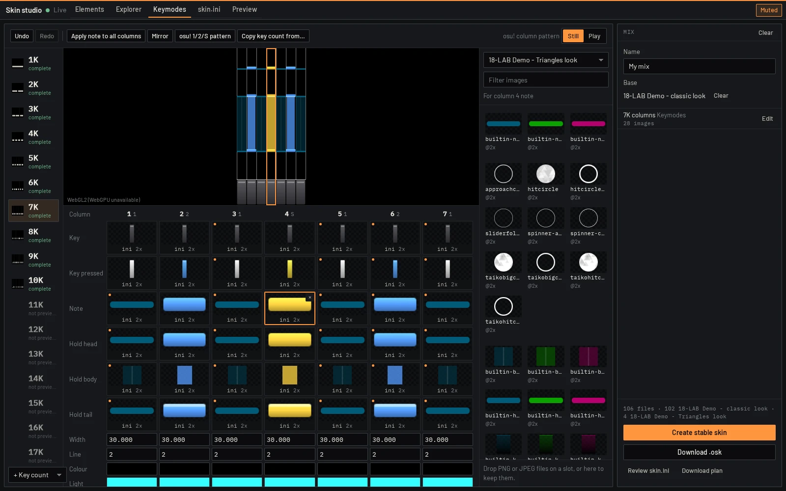

# Skin studio

Browse osu! skins, edit the skin osu! uses (staged until applied), preview their elements, mix element groups from several skins into a new skin, and edit skin.ini with wiki-backed completion and checks.

Interface: **UI only**. Its native backend starts on demand for the studio and stops when idle; it is not a standalone background service.



## Sources

- **Stable**: folders in the stable `Skins` folder (setting `stable_skins_dir`, else `<osu_dir>/Skins` of the attached stable client). Read and written.
- **Added folders**: any folder with `skin.ini` or lazer's `skininfo.json` (for example lazer's skin editor → File → Edit externally… folder), added from a dashboard session and kept in the tool's data folder. Only `skin.ini` is ever written there.
- **`.osk` files**: added by path like folders (`POST /v1/folders/add` accepts an absolute folder or `.osk` file) and read in place from the archive; never written. Entry names are normalised to `/` and names that would leave the skin are skipped.
- **Lazer**: imported lazer skins through the optional [`lazer-library`](../lazer-library) tool (`GET /v1/skins`, `/v1/skins/<id>/files`, `/v1/skins/<id>/file/<name>`). Skin studio does not list it in `[[requires]]`, so it keeps working without it; those routes are open read routes and are requested without this tool's token. Lazer skins are read-only; built-in lazer skins have no files and are listed but not browsable.

## The draft and Apply

There is one mix draft. Its **Base** (Mix panel) is by default the skin osu! uses (**Follow osu!**: the attached client's current skin, followed while the draft holds no changes); **Use as mix base** or the Base list picks another skin, or **No base**. Group picks, single assets, Keymodes slots and values, hit position and calibrations, proportions and hand edits of the draft's skin.ini (**Mix draft** on the skin.ini tab) all go into that draft, kept in this browser; nothing touches a skin until **Export as** runs.

**Apply to current skin** (or **Apply to *name*** when the base is another skin) is the first entry of **Export as** for a stable or added base, and the default choice until another is picked: it writes the draft into the base itself, keeping the base's `[General]` (a hand-edited draft skin.ini gets the base's own `Name`/`Version` back, `keepGeneral` in `web/src/plan.ts`). For a lazer base, Apply is offered only while lazer's **Edit externally** has the skin mounted (**Apply to *name* (Edit externally)**); otherwise the entry is **Import into osu!lazer (new skin)**, next to the `.osk` and other exports. The panel shows *N unapplied changes* (from a review the service computes) and, after an apply to a folder, **Restore last apply**. The first apply in a tab lists every file it adds, replaces or removes and where.

**Undo** and **Redo** (Mix panel, Ctrl+Z / Ctrl+Shift+Z or Ctrl+Y on any tab) step through every change of the draft: Keymodes edits, group picks, single assets, carried settings, the base, and **Discard draft**. Discard draft asks first, naming what is lost (group picks, assets, the key counts with Keymodes edits, hand edits to skin.ini, a chosen base), and then empties the draft back to following osu!; Undo brings it back while the page stays open. An apply empties the draft (its changes are on disk) and starts a new history.

**Drafts from before the single draft.** Earlier versions kept two drafts behind a Current skin / New skin switch. On first load the new-skin draft becomes the draft, keeping its base (or none). An edit-in-place draft with changes is kept aside as the **Saved draft** shown at the top of the Mix panel: **Open** makes it the draft (still applying to its skin) and keeps the draft it replaces as the saved draft, so either can be reopened; **Discard** deletes it after a confirmation naming what it holds. An edit-in-place draft without changes is dropped. `web/e2e/ux.e2e.ts` seeds both legacy shapes.

- **Stable and added folders** (`POST /v1/review`, `POST /v1/apply`): only changed files are written, each staged next to its target and renamed into place, rolled back on any failure. Every file replaced or removed is first copied to `backups/<id>/` in the tool's data folder; `POST /v1/restore` (**Restore last apply**) puts the newest apply back by content, leaving files changed since alone (`GET /v1/applied`). Renames and removals wait up to 2 s for a file another program holds open (Windows sharing violations). A rollback deletes the backup only when every file went back; otherwise the backup is kept, marked `rollback_incomplete` with the files that failed, and the error names them and the backup folder. An apply interrupted mid-way is marked too (`applying`). The studio checks `GET /v1/applied/unfinished` when it opens and offers **Restore**, which finishes a partial apply or rollback. Files the draft does not change are never touched, and a file is removed only when the draft removes it (a group set to the built-in look, or Skin studio's own file no key names any more, see below). skin.ini keeps its BOM, its `[General]` and the line ending of every line the draft did not change. An apply refuses (and asks for a new review) when the skin changed on disk after the review.
- **osu!lazer** keeps skins in its own file store. When lazer's skin editor has the skin open in **Edit externally** (`<temp>/<skin hash>`, `RealmArchiveModelImporter.BeginExternalEditing`), the apply writes into that folder like a stable one and lazer's **Finish editing** replaces the skin in place (`SkinImporter.ImportAsUpdate`, same skin ID): the way to edit a lazer skin without duplicates. Otherwise lazer cannot replace a skin from outside: its skin hash covers only `.ini`/`.json` files (`SkinImporter.HashableFileTypes`), and an import whose skin.ini differs is a new skin (`RealmArchiveModelImporter.CheckForExisting`), so the apply imports the edited skin as **`<name> [vosu edit N]`** (the `.osk` file carries the same name, else lazer appends it), written to `lazer-imports/` and handed to the running lazer by starting its executable with the path, which forwards it over lazer's IPC and exits (`osu.Desktop/Program.cs`, `ArchiveImportIPCChannel`; on Linux the process found in `/proc`, started with its own environment; on Windows `%LOCALAPPDATA%\osulazer\current\osu!.exe`). lazer shows "Imported … Click to view" to switch to it; the game is never restarted. Without a running lazer the file stays for dragging in.

**Read-only tabs.** vosu gives a tab a write session only when the dashboard opens it (a one-time launch code); a reload, a restored tab, an expired code or a vosu restart (an update) leaves it read-only. Drafts need no session, so the Keymodes screen and hit position keep working; applying, exporting, dropping files and saving need one. The header badge **Read-only · Open from the dashboard** links to the dashboard's Tools page and says which case it is (a vosu restart is detected from its 403 on the next write).

## Mixing

A mix is a base skin (optional) plus per-group picks: a source skin, `default` (leave the elements out so osu! uses its default skin) or `blank` (invisible 1×1 PNGs / silent samples). Groups are per ruleset (`web/src/groups.ts`): hit circles, combo colours, sliders, spinner, judgements; taiko drum, notes, judgements, pippidon; catch fruits, catcher; default mania elements plus one group per `[Mania]` key count (the whole block and the images it references); cursor; numbers and fonts (including files under their skin.ini prefixes); HUD, song select, mod icons, main menu, pause/fail, results; hitsounds, spinner/combo sounds, interface sounds. A group owns its element files (`name`, `name@2x`, animation frames `name-N`/`nameN`) and its skin.ini keys; image and prefix keys bring the files they reference.

`blank` writes an invisible file under the name of every file the base had in the group (`@2x` and animation frames included, so wildcard groups such as default mania elements are covered too); without one the client would fall back to its built-in look, e.g. lazer's grey classic `mania-stage-hint`. A base file that a skin.ini key the mix keeps still names (say another key count's `StageHint: mania-stage-hint`) is kept whatever its group's pick. When `default` or a source skin leaves base elements to the client's built-in look, the Mix panel says so in one line under the group.

### Single assets

On top of groups, a mix can take single assets from any skin (`overrides` in the recipe, `web/src/assets.ts`). A unit is an image with its `@2x` variant and animation frames, a sound, or a font (a skin.ini prefix's glyph set, e.g. `score-*`). An override wins over its group's pick and the base. Lookups follow the clients' legacy rules, so taking a file also carries the skin.ini keys that make the client draw it:

- a `[Mania]` image key (`NoteImage0`, `KeyImage1D`, `StageLeft`, …) that names the file in the source's block for that key count is copied into the mix's block, so the mix draws the file instead of whatever its own block names;
- a font unit sets its prefix key (`HitCirclePrefix`, `ScorePrefix`, `ComboPrefix`) to the copied prefix, keeping prefixes other units still use;
- files that no key names and that are not looked up by default name are kept but marked "unused";
- where an asset depends on configuration that would change other things (for example a font's `HitCircleOverlap`, a mania column's `ColumnWidth`), the Mix panel offers to carry it instead of doing it silently (`carry` in the override).

The UI composes the mix into a build plan:

```json
{
  "name": "My mix",
  "overwrite": false,
  "ini": "[General]\r\nName: My mix\r\n…",
  "sources": [{ "skin": "/…/Skins/Base", "files": ["hitcircle.png", ["from.png", "to.png"]] }],
  "blanks": [{ "to": "cursor.png", "kind": "png" }]
}
```

`skin` is a library key from `GET /v1/library` (an absolute folder, or `lazer:<id>`). `POST /v1/build` (write route) creates a stable skin: output is staged in a hidden folder inside `Skins` and renamed into place; an existing skin of the same name is replaced only with `overwrite: true` (the UI asks first) and is swapped atomically. `POST /v1/exports` (write route) accepts the same plan for an `.osk` (a zip lazer imports) and answers `{"url":"v1/exports/<id>","filename":"<name>.osk"}`; `GET` on that URL streams the archive once as a download, within a few minutes. Nothing is written outside `Skins`; the browser saves the `.osk` where the user chooses. With `credits`, `skin-studio-credits.txt` lists the source skins.

**Export as** in the Mix panel chooses the target: osu! stable folder, osu!lazer `.osk`, **Quaver** or **Etterna**, with a line naming what the target skips or approximates. Quaver and Etterna take the mix's osu!mania stages only: the page resolves every `[Mania]` key count the way lazer draws it and sends the stages with the plan to `POST /v1/exports` (`"target": "quaver" | "etterna"`); the service reads, converts and zips everything before it answers (a failure never starts a download), returns the report (`exported`, `skipped` key counts with reasons, `notes`) and keeps the archive for one download as with `.osk`: `<name>.qs` for Quaver (key counts 1K–10K), `<name> (Etterna).zip` with a noteskin per key count under its Etterna game (3K–10K) and a judgement asset. Mapping, sources and what was verified in each game's loader: [EXPORT.md](EXPORT.md); end to end: `web/e2e/export.e2e.ts`.

**Download plan** in the studio saves the mix recipe as JSON for inspection.

A key-count group (`NK stage`) also carries the images its source block leaves to default names (`mania-key1`, `mania-note2H`, `lightingN`, `mania-hit300`, …): the source draws its own files under those names, so the mix copies exactly the files the lookup reads (frames before a plain image for animated pieces, `@2x` kept) into `mania/<N>k/` (see Key-count folders) and names them in the block. The mix's own default-named files stay for its other key counts. Receptors and notes that still come from osu!'s built-in look are named under the group.

## Keymodes

The **Keymodes** tab edits the mix draft's `[Mania]` blocks column by column. Elements and Preview stay the place to browse what a skin's key counts look like; this screen is where a mix chooses images per column.

If a draft's source disappears, a **Missing source** banner includes hidden geometry originals (even when the composed plan only uses retained uploads), the stored skin name or old identifier, slot count, and affected key counts. Width/HitPosition edits refresh the library before reading geometry and stop with this recovery guidance instead of trying to read the vanished skin. Choose **Remap** to relink the references to a same-name library skin (old unnamed drafts offer all skins); every referenced file must exist. An identical full-content hash is preselected, never applied automatically. **Keep derived images** retains the uploads at their current geometry and rebases subsequent edits onto those files; previous resampling/cropping is accepted and lost pixels cannot be restored. If a slot has no retained upload, Keep explains why it cannot work. **Remove slots** drops the affected overrides and geometry references back to the base skin. Recovery of all affected key counts is one atomic undo/redo step and works in read-only browser tabs too.

New image references persist `sourceName` and, for lazer-library versions supplying it, `sourceHash`. This SHA-256 includes every filename and file-content hash in sorted filename order (length-prefixed UTF-8 names); it is **not** lazer's `.ini`/`.json`-only skin hash. Older drafts cannot retrospectively identify deleted skins. Deleting a source, or replacing it by an import with another ID, can orphan a draft. An ordinary Skin studio `.osk` Apply creates a separately named `[vosu edit N]` skin without deleting the source; Finish editing in lazer's external editor updates the same ID.

Run the isolated recovery e2e with `bun tools/skin-studio/web/e2e/lazer.e2e.ts --missing-source --playwright <playwright/index.mjs> --assets <vosu>/assets/server --skins <copied-skin-parent> --skin <copied-skin-folder> --out <evidence-folder>`. It removes source A from the stand-in lazer-library after deriving images, checks load/edit detection, remap/keep/remove with undo/redo and further width edits, and captures both themes at 1920×1080. No real lazer process, database, browser profile, or live tool data is used.

For same-name copies, the replacement list shows the creator, file count, and how many referenced filenames exist in each candidate, ordered by overlap. Overlap is only a relevance hint, not proof that the pixels match. Only an exact full-content hash is preselected; without that, the user chooses. When neither the draft nor the Realm snapshot retains the old name, the banner explicitly says **Unknown source skin** and offers all library candidates with the same overlap information. The pinned lazer `SkinInfo` stores no import date, so the studio cannot truthfully say which same-name copy is newest. The recipe's `sourceInfo` also retains names/fingerprints for base skins, group picks, and individual overrides.

The recovery banner stays on one compact row. The replacement picker's help hover explains date/hash/filename relevance; the help beside **Keep derived images** explains retained-geometry limitations. Both help controls are keyboard-focusable.

- **Key counts** (left): every key count the draft's skin.ini has a block for, plus **Add key count** (1K–10K). Each shows a diagram of its stage (render-core's layout and column colours) and a status: *complete*, *falls back* (a column image comes from osu!'s built-in look) or *missing images* (a key or note draws nothing). 12K–18K dual stages are listed but not edited, because render-core does not draw them.
- **Stage** (centre): the key count drawn by render-core as a still frame (keys up; in every column a note nearest the receptors and a hold above it, placed from the skin's receptor, note and tail heights so nothing overlaps at any scroll speed, render-core `maniaStillTimes`) at the draft's own layout, or **Play** for the looping demo. Clicking a column selects it; images dropped on a column set the selected role there.
- **Slots**: a grid with one grid column per stage column (so a slot sits under its column) and one row per image role: Key, Key pressed, Note, Hold head, Hold body, Hold tail; then, under **Column values**, Width, Line width, Colour and Light colour (`ColumnWidth`, `ColumnLineWidth`, `Colour#`, `ColourLight#`). Each slot shows the image the client draws, where it comes from (`ini`: the block names it; `default`: found under its default name; `built-in`; `missing`; `→ note` when a hold head or tail draws another piece), `@2x` and frame count; the tooltip has the key and raw value, and the help beside **Column** explains the tags.
- **Groups under the grid**, collapsed when the page opens (open ones stay open while it stays open, across tabs and key counts): **Hit position**, **LN length**, **Stage images** (StageLeft/Right/Bottom/Hint/Light, LightingN/L, Hit0–Hit300g) and **All [Mania] settings**.
- **Picker** (right): images of the mix draft, dropped files or any library skin (stable, added folders, `.osk`, lazer), each with its `@2x` and frames. With a slot selected, images the source's own skin.ini uses for that role come first, then names that match the role.
- **Assigning**: select a slot, then click an image; or drag an image onto a slot or a stage column; or drop PNG/JPEG files from the desktop onto a slot (one image with its `@2x` and frames) or onto the picker (any number). Dropped files are checked (a file name, not a path; PNG or JPEG by content; at most 1 MiB, the most vosu passes to a tool; frames `-0`, `-1`, … without gaps), stored by the service (`POST /v1/uploads`) and offered as **Dropped files**. Problems are reported under the grid.
- **Bulk actions**, each one undo step: **Apply to all columns** in the toolbar (the selected slot's image in every column); under **Column tools**, **Mirror** (column `N-i` takes column `i`: 7↔1, 6↔2, 5↔3 in 7K), **osu! 1/2/S pattern** (every column takes the images of the first column of its kind, the kinds behind osu!'s default names) and **Copy from** (another key count of this mix or of any skin; when the counts differ each column takes the source column of the same kind nearest in relative position).
- **Selecting several slots**: Ctrl+click (Cmd on macOS) toggles a slot, Shift+click selects the rectangle (columns × roles) from the last slot clicked, Shift+arrows grow it, Ctrl+A selects the whole grid, Escape clears. Picking an image, dropping a file or an image on a selected slot, Delete and the Explorer's **Use for N slots** apply to every selected slot as one undo step; one image for slots of different roles (a key and a note) is allowed and the status line says so. The grids are `aria-multiselectable`, slots `aria-selected`.
- **Selecting several values**: the per-column values (Width, Line width, Colour, Light colour, and every per-column field of the [Mania] form) select like slots, within one row: Ctrl+click toggles a column, Shift+click selects the run from the last one, Shift+Left/Right grow it, Ctrl+A selects the row, Escape clears (modifier clicks open no picker and flip no switch). Typing a value (Enter or leaving the field), picking a colour (each column keeps its alpha) or flipping a switch sets every selected column, in one undo step; widths keep proportions once for the whole change. A selection does not span rows: each row holds another kind of value. **Apply to all columns** copies the focused value field's column to its whole row, or the selected slot's image to its role.
- **Keyboard**: arrows move between slots and fields, Enter selects a slot and moves to the picker (arrows, Enter assigns, Escape returns), Delete or Backspace clears the selected slots and Escape the selection (wherever focus is on the screen, outside text fields), `[` / `]` show the previous or next key count, Ctrl+F goes to **Filter images**, Ctrl+Space toggles one slot. See Keyboard shortcuts below.
- **From the Explorer**: with a slot selected on this screen, the Explorer's **Use as 7K column 4 key** (the slot's name) sets it to the selected image and switches back here. Explorer images can also be dragged: holding the drag over the Keymodes tab opens it, then drop on a slot or stage column. Tab switching was chosen over a split view: both panes need the width, and the Explorer's tree and list stay as they are.

- **All [Mania] settings**: a form for the rest of the key count's block, generated from `packages/skin-spec`'s schema (`web/src/mania-form.ts`): every `[Mania]` key has exactly one control on this screen (tested). Per-column keys and comma lists (ColumnSpacing as gaps between columns, LightingN/LWidth, NoteBodyStyle#, the upside-down flips) are rows aligned under the columns; the others are typed fields grouped Stage, Positions, Notes, Lighting, Colours (numbers with the schema's range, switches, selects, colours with alpha), each showing its default when unset and a reset that leaves the key out. Values are read from the draft's skin.ini, so hand edits show here; changes go through the draft (one undo step each), and the line-preserving `[Mania]` writer keeps unknown keys, comments, order and line endings.

### Key-count folders

Every image Skin studio writes for a key count goes to `mania/<N>k/` (lowercase; lazer and Windows look files up case-insensitively, Linux stable does not, so skin.ini names them exactly as written): Keymodes slot copies, stage-group copies of default-named images, receptors moved by HitPosition, images rescaled to keep proportions, calibrated hold ends, dropped files assigned to a key count. Images not tied to a key count keep their place: single-asset overrides and group picks use their element's own names, dropped files not yet assigned stay in the tool's data folder, and `skin-studio-credits.txt` is at the root.

Many skins have a `mania/` folder of their own, so each `mania/<N>k/` Skin studio writes into gets `.skin-studio.json`, listing the files it generated there (the service reports them as `owned`). A name a foreign file has is never taken (`name (2)` instead); Skin studio's own files no key names any more are dropped (removed by an in-place apply, with backup); only listed files are ever replaced or removed. Skins made by earlier versions name `skin-studio/<N>k/` copies: composing moves the ones a block still names to `mania/<N>k/` and drops the rest of that folder, which only Skin studio wrote.

### Keep proportions when changing column width

osu! stretches pieces to the column width without scaling their height, so a wider or narrower column distorts them (lazer 2026.1005.0):

- **Keys** (`LegacyKeyArea`): as wide as the column, as tall as the texture (DisplayHeight: pixels, halved for `@2x`), standing on the stage's bottom.
- **Notes, hold heads and tails** (`LegacyNotePiece`): scaled by (column width, note height width) / texture width, the note height width being WidthForNoteHeightScale, else the stage's narrowest column (`LegacySkin.GetConfig`). They keep their look when every column changes alike; otherwise they are stretched.
- **Hold bodies** (`LegacyBodyPiece`): as wide as the column and as long as the hold. Stretched (`NoteBodyStyle: 0`), detail across the column scales with it and along it follows the hold: nothing to do. Repeated (other styles), the image is stretched over 32800 units whatever its height, so its pattern does not scale with the width.

With **Keep proportions when changing column width** (per key count, on by default; the first width change says so) a width change makes each piece look as if its column were scaled uniformly by s = new / old: keys are resampled by s in both axes about their bottom edge; notes, heads and tails have their height resampled by s × nh / nh′; repeated bodies change height to H / s by cutting rows or repeating the image from its top (exact, no resampling); stretched bodies are left alone. HitPosition follows the receptors: **HitPosition′ = round(480 − (480 − HitPosition) × s)**, s being the scale most columns share (ties: the one nearest 1), counted from the widths the pieces had when first changed, so changing columns one by one ends where changing them together would. A column with another scale has its receptor scaled about the point that stood on the old hit line and moved onto the shared line by its own sub-pixel offset. LightPosition moves with HitPosition.

Both osu!stable and lazer use the narrowest column as the note-height reference when `WidthForNoteHeightScale` is absent: see the pinned [osu! skin.ini specification](https://github.com/ppy/osu-wiki/blob/cc0a5b726902569dad62a011a7eba5b9030560f3/wiki/Skinning/skin.ini/en.md) and lazer's [LegacySkin](https://github.com/ppy/osu/blob/97e94babde9d5ecbe574ecdd33509db27452cd0f/osu.Game/Skinning/LegacySkin.cs) lookup. When narrowing one column would otherwise change other columns' note heights, Skin studio temporarily writes that original reference as `WidthForNoteHeightScale`, rather than rewriting untouched notes to compensate. The tool-owned value follows the scale shared by the columns; it is removed again when the implicit default gives that reference, including a full round trip. An explicitly set value is never rewritten or removed. With uniform widths changed together, the implicit reference scales along and note images need no height resampling.

Order of changes to one piece, in one undo step: the image as it was before the first geometry change (including any earlier LN calibration), then previously recorded receptor moves inside its canvas with the column-wise edge-clamp fill, then proportion scaling of the whole canvas. With **Move receptors with HitPosition** on, manual field/calibration changes add receptor moves; residual rounding and mixed-column alignment follow the shared landing line without cutting. With it off, new HitPosition changes only move the note landing line: no key images or LightPosition are rewritten. Width changes still rescale images, but skip the HitPosition-driven residual shift. Prior image moves stay baked into the displayed geometry; re-enabling movement does not catch up line-only edits. Line-only displacement is retained separately in the draft's geometry metadata so future scaling and moves don't replay it. Every derived operation starts from captured originals, not a resampling of a resampling; returning to original geometry restores original images.

Choosing a new image establishes a new geometry baseline for that key count; the other currently displayed images are retained. Captures from the previous selection are not reused alongside newly selected receptors. Older drafts with changed selections, changed sources, or mixed receptor HitPosition epochs are rebased from their current selections on the next width edit (even entering the same width). This repair is part of the normal undoable width change; later width round trips return to that new baseline rather than resurrecting an older skin's images.

If an older operation has already restored old blank receptor selections, the original stage cannot be reconstructed safely from those captures. Only in that detected state, and when the currently selected stage source is available, **Reset geometry from original stage** appears. It restores that source's receptor/note images, widths, HitPosition, note-height reference and body style for this key count, discarding the stale capture history. Other key counts, colours and the receptor-movement toggle are retained. This is one undoable draft change, not an edit to the source skin.

Asynchronous geometry, stage copying, missing-source recovery and LN calibration retain their target key count. Each checks a per-count draft generation before committing: selection changes, clear, undo/redo, reset, base or source replacement and hand edits invalidate older work, including an edit followed by undo back to the same content. A stale result reports that it was not applied instead of merging old images or captures into a newer draft.

Resampling (`src/resample.rs`, `POST /v1/derive` op `resize`) works in linear light with premultiplied alpha (no dark fringes from transparent pixels), with a separable Lanczos-3 filter widened by 1 / s when downscaling, and every sample clamped to the range of the source pixels under the kernel's main lobe, which removes Lanczos' overshoot halos. Both the 1x and the `@2x` file are made from the `@2x` source when there is one (a downscale, never an upscale of a smaller image), each at its exact target size (round(size × s)), all animation frames included. On a synthetic image of 1 px rings and an anti-aliased disc on transparency at 0.7×, 0.9×, 1.1× and 1.5×, SSIM against the analytic ideal is ≥ 0.984 and the largest overshoot past the ideal's local range ≤ 0.075 (plain Lanczos-3: up to 0.208); `cargo test` asserts SSIM > 0.98 and halo < 0.08. Results are cached by (source, operation) in the page and in the service, which derives a batch in parallel; a typical 7K width change took 36 ms with a release build (8 images, a 96×27791 repeated body included), up to 213 ms when every column's pieces change at once. Geometry changes run one after another, each from the skin.ini the previous one left.

### Hit position

The shown key count's **Hit position** group has a plain `HitPosition` number field: type or use native one-unit arrow steps, then Enter or blur to commit one undoable change. There are no separate increment/decrement buttons. The scale explanation is a help hover on the label.

- **Scale**: one HitPosition unit is 1.6 image pixels, 3.2 in `@2x` images: skin.ini positions are on a 480-tall stage that lazer draws 768 tall. A lower HitPosition raises the note landing line.
- **Move receptors with HitPosition**: on by default, separately stored and undoable for each key count. Uncheck it to leave receptors where their images draw them and move only the landing line, including with **Calibrate hit position**. For a 5K skin at HitPosition 480 with raised receptors, lower the field until the notes meet the receptors: the preview updates immediately and exported receptor images remain byte-identical. The toggle itself never changes any pixels.
- **What moves**: lazer draws key images (`KeyImage#`, `KeyImage#D`) on the stage's bottom edge at their own height (`LegacyKeyArea`), so the receptor graphic inside them is moved: new copies (sources are never written) on the same canvas, every frame and both scales, by whole rows (1x moves of 1.6 px per unit are rounded). Vacated rows repeat, per pixel column, the moved content's adjacent row (alpha included): moving up, the freed bottom rows take the colour above them; moving down, the freed top rows take the colour below them; transparent columns stay transparent. Every move starts from the images as they were before the first one, so moves never stack. `LightPosition`, when set, moves by the same amount, since lazer places the column light from it (`LegacyColumnBackground`). The hit target, hit lighting and judgements are already placed from HitPosition by lazer (`LegacyHitTarget` and the explosions in `HitTargetInsetContainer`, `LegacyManiaJudgementPiece`) and are left alone. A HitPosition change re-makes only key images: notes and hold pieces are drawn by the scrolling, not placed from the hit line, so they change with column widths only (Keep proportions). A width change that drops rows (a repeated hold body's tile made shorter, a receptor moved past its canvas) is reported once, naming the key count, columns and piece.
- **Last play** (`GET /v1/plays/last`): the newest completed local osu!mania score of the attached client, else the other one. osu!stable keeps a replay of every completed local score in `Data/r/<map MD5>-<FILETIME>.osr` (the osu! folder is vosu's, or the parent of the Stable Skins folder setting, so osu! need not be running); its map comes from `osu!.db` and the Songs folder, checked by MD5. osu!lazer's come from the `lazer-library` tool (`/v1/scores/recent`, replay and `.osu` read inside lazer's file store). Replays rather than live capture, so Skin studio need not be open while playing.
- **Offsets**: the replay is judged by `packages/replay` with its client's rules on the map with its mods (converts included, so the key count is the played one); map time is divided by the clock rate. Press samples are timed note/head events with misses left out. LN samples are physical hold releases accepted by the client's non-miss/non-combo-break rules, including a physical release after an accepted NoRelease automatic tail. At least 50 accepted samples are needed. The proposal shows used/total samples, excluded early and late separately, mean and spread; re-grabbing a dropped hold can produce multiple physical release samples. See [the real-play acceptance audit](ln-release-audit.md).
- **Separate calibrations**: Keymodes exposes **Calibrate hit position** in Hit position (press timings → receptors / HitPosition), and **Calibrate LN length** in LN length (release timings → hold tails). Either reads the last play independently; neither needs the other. Each proposal shows title, played key count, client, relative age and absolute local time. Plays at least an hour old, or older than a play already seen in this session, are flagged. Only completed, saved mania scores with replays are candidates, not every attempt. Wrong key counts and insufficient presses/releases are explained in the relevant group; applying either is a separate undoable change.
- **Release windows**: use the replay judge's own OD, mods and client rules, rather than a separate calibration cutoff. Lazer [tail judging](https://github.com/ppy/osu/blob/97e94babde9d5ecbe574ecdd33509db27452cd0f/osu.Game.Rulesets.Mania/Objects/Drawables/DrawableHoldNoteTail.cs) divides the offset by 1.5 before judging; its outer non-miss edge is the lenient Meh window. [ManiaHitWindows](https://github.com/ppy/osu/blob/97e94babde9d5ecbe574ecdd33509db27452cd0f/osu.Game.Rulesets.Mania/Scoring/ManiaHitWindows.cs#L134-L169) accounts for rate/difficulty multipliers, OD and converts, using Classic's legacy table only without ScoreV2. Stable ScoreV1 drops releases earlier than its Meh window but accepts held late releases as judged (even very late ones); those remain included and are separately reported as “K very late releases included, as stable judges them”. Stable ScoreV2 uses 1.5× release lenience, the Meh edge early and Ok edge late. Window-edge comparisons and replay-header ambiguity settlement remain the judge's, not a new outlier heuristic.
- **Speed**: lazer's `DrawableManiaRuleset` gives notes 11485 / speed ms over the scroll length at the default hit position (643.2 lazer units), independent of the hit position and of rate mods (`updateTimeRange`), times the slider velocity and the map's main beat length over the current one (`RelativeScaleBeatLengths`). osu!stable's speed uses the same scale (lazer adopted it; stable's code is closed); its "scale scroll speed with BPM" option off leaves the beat-length factor out. The speed comes from vosu's live mania settings (stable's per-beatmap speed when that is on); vosu reports them only while a client is attached, so otherwise it is typed in. The median note speed of the hits is used, so slider-velocity effects do not decide.
- **Receptors (correcting)**: mean press offset × speed sets the magnitude, with the opposite sign applied to HitPosition (÷ 1.6). Late presses raise the receptors and hit line (lower HitPosition) so you press earlier; early presses lower them so you press later. The proposal states the timing and direction plainly, with a help hover explaining that calibration corrects timing rather than matching it. The original column-fill rule and per-key-count scope remain.
- **Hold ends (correcting)**: late releases shorten the drawn LN by mean accepted release offset × note speed, so you release earlier; early releases lengthen it so you release later. Existing percy skins shift body content in the opposite direction to the measured offset, within their clear-row allowance. Shortening normal holds uses the existing percy conversion: blank spacer tail, flipped cap drawn into a repeating body stretched over 32800 units at the cap's scale. Lengthening uses transparent rows before the normal cap, with the body reaching it. Cap pixels remain exact at their native resolution, body texture is sampled nearest-row, and repeating `NoteBodyStyle` is set when needed. Derived images remain scoped to `mania/<N>k/`; every SD/HD file and animation frame is transformed. Conversion combines different cap/body loop lengths over their least common multiple at the skin's existing frame rate, without flattening animation. Zero offset changes nothing. **Behaviour change from 0.4.x:** those versions matched your timing; re-calibrating a previously calibrated skin now moves it the other way to correct your timing.

Hold-end calibration shares work only for identical tail/body file units, release displacement, note-height scale, body style and scroll orientation. Derived images with the same display name but different pixels remain independent. Editable image units retain their plain fallback files alongside every animation frame and density, even when the preview draws only the animation.
Normal-hold conversion keeps SD/HD output when it fits the existing 65,536-row service ceiling. If native HD would exceed it, the proposal explicitly names the required HD height and says **using SD**; conversion then preserves the animation loops at SD, downsampling HD-only inputs rather than silently dropping their density marker. The backend ceiling is unchanged.

**Copy key count from…** copies the whole stage's schema-defined appearance, including HitPosition, note-height scale, global and per-column body styles, flips, spacing, positions and colours. Lists and numbered settings follow the same column remapping as images; missing source values reset target overrides. The destination's Keep proportions and Move receptors preferences remain unchanged, and copied images establish a fresh capture baseline.

Keymodes actions use the same whole-recipe history as other draft edits. Undo restores the actual previous overrides and hand-edited skin.ini bytes; undoing a first edit removes that key-count override rather than manufacturing a value-only draft.

Data model: the recipe's `keymodes` holds per key count the slots (`{skin, name, files}` to copy, `{value}` for an image the mix already has, or `null` to leave the key out) and values. Composing applies them after picks and overrides: the block is created when missing, image copies go to `mania/<N>k/<name>` (one copy per image however many columns use it; `<name> (2)` when two images share a name, since `-2` would read as a frame) and each key is set to that path without extension. When the draft skin.ini was edited by hand, a Keymodes change writes just the keys it touched into it; hand edits of a block show on the screen, since it reads the draft's skin.ini. Building and `.osk` export are unchanged: the files and keys travel in the plan.

Dropped files live in the tool's data folder (`uploads/<drop>/<name>`; one folder per drop, named from the files' content) and are never deleted automatically: mix drafts live in the browser's storage, which the service cannot see, so no age or startup rule can tell whether a draft still needs a file. The Mix panel's **Dropped files: N (size)** lists them and marks the ones the current draft uses. **Remove unused** deletes only the others, after a confirmation naming their count and size and warning that other open Skin studio tabs or saved drafts in other browsers may still use them; the page sends exactly those names (`POST /v1/uploads/remove`) and the service deletes nothing else. Names differing only in case are refused, since osu! and Windows treat them as one file.

Upload reachability includes current slots, hidden geometry originals and prior selections in every key count, group/stage picks, single assets, the base, the saved draft and all retained undo/redo snapshots. The list distinguishes files **kept for undo** from live draft dependencies; the deletion dialog reports both the unused count and the count kept for undo. Unknown recipe dependencies are protected until the upload source loads. Clearing or evicting history can make history-only files unused; no files are deleted automatically.

`web/e2e/keymodes.e2e.ts` checks the screen end to end on two real skins in an isolated vosu (`vosu --tool`, private network and PID namespaces, SwiftShader, temporary HOME and XDG folders): assigning by click, drags onto a slot and a stage column, Explorer assignment and drag, a desktop drop with an invalid file, removing unused dropped files (declined, then confirmed), Mirror, the 1/2/S pattern, Copy key count, undo and redo, a hand edit of skin.ini, thumbnails, colour swatches, page scroll at four window sizes, an `.osk` export whose skin.ini and files are read back and whose render-core stage is compared with the screen's, and a whole 7K stage group exported from a block naming no images.

Lookups follow lazer's legacy mania rules (ppy/osu 2026.1005.0-lazer, `osu.Game.Rulesets.Mania/Skinning/Legacy`): `LegacyKeyArea` looks up `KeyImage#`/`KeyImage#D` else `mania-key{F}`/`mania-key{F}D` as textures; `LegacyNotePiece`, `LegacyHoldNoteHeadPiece` (head, else note), `LegacyHoldNoteTailPiece` (tail, else head, else note) and `LegacyBodyPiece` look up `NoteImage#{,H,T,L}` else `mania-note{F}{,H,T,L}` as animations; `F` is `LegacyManiaColumnElement.FallbackColumnIndex` (`S` for an odd stage's middle column, else `1`/`2` alternating from the edges). `getManiaImage` in `osu.Game/Skinning/LegacySkin.cs` reads the first `[Mania]` block for the key count (`LegacyManiaSkinDecoder` drops later duplicates); `LegacySkinExtensions.GetTextures` takes the first skin providing `name-0` or `name`. render-core implements these as `maniaImageKeys` and `resolveManiaImages` (`packages/render-core/src/mania.ts`). A second `Keys:` inside one `[Mania]` section starts the next configuration, as `LegacyManiaSkinDecoder` reads it (a header typo such as `[Mania` does not merge two key counts).

## Keyboard shortcuts

**Shortcuts** in the header, `?` or Ctrl+/ opens the sheet listing every binding (`web/src/shortcuts.ts` decides which key does what where; the sheet is generated from the same table). On any tab: Ctrl+Z undoes the last draft change, Ctrl+Shift+Z or Ctrl+Y redoes it, Ctrl+F goes to the tab's filter (Filter skins, Filter files, Filter images; on the skin.ini tab the editor's find), Ctrl+Enter runs the chosen **Export as**, Ctrl+S saves the selected skin's skin.ini. Text fields keep their own Ctrl+Z, Ctrl+F, arrows, Delete and `?`; the skin.ini editor keeps every key (Monaco's undo, find and comment). Ctrl+Enter and Ctrl+/ also work from a text field. There are no tab-switching shortcuts. `web/e2e/ux.e2e.ts` checks every binding, inside text fields and the editor too, and the sheet.

## Explorer

The **Explorer** tab is an in-page browser (no native file dialog) for any library skin, with its own skin switcher so one skin can be browsed while another is focused: a folder tree, a virtualised file list (name, asset, kind, size, pixel size measured from the image) with a filter, and a details pane (image or animation preview, sound play button, text view of `.ini`/`.txt`/`.json` up to 2 MiB through `GET /v1/asset`). **Assets** lists one row per mix unit (an image with its `@2x` variant and frames, a sound, a font's glyphs; `unitOf` in `web/src/assets.ts`), **Files** one row per file. Selected rows (click, Ctrl/Shift+click; keyboard: arrows, Shift+arrows, Space, Ctrl+A, Enter, Escape; Down from the filter) go into the mix as single-asset overrides with **Use in mix**; when everything selected already is, the button removes it. Sounds play only from their play button. Elements tiles and Mix override rows have **Files** to reveal an asset here, and **Show in Elements** jumps back to its tile. Nothing in the Explorer renames, moves or deletes files.

## Previews

`GET /v1/asset?skin=&name=` serves images and audio; `GET /v1/animation?skin=&element=` assembles an element's frames into a looping APNG at the skin's `AnimationFramerate` (or the whole sequence over one second when unset), cached by content hash in the tool cache folder (`animations/`).

The **Preview** tab plays a short looping demo map per ruleset (`packages/demo-maps`: osu!, taiko, catch, and mania 1K–10K) through the shared renderer (`packages/render-core`: WebGPU, or WebGL2 without it; the preview status names the one drawing) with the selected skin, including unsaved skin.ini edits, or the mix draft with its overrides. Mania offers exactly the key counts that have a `[Mania]` block with `Keys: N` in the previewed skin.ini, in order (lazer's default 4K and 7K when it defines none); dual-stage counts above 10K are listed but not previewed. Only the shown key count's stage is decoded. It is muted and draws nothing while hidden.

Mania scrolls at the running osu! client's speed and direction (vosu's `/settings/mania`, followed live, picked like Map preview and Practice by `@vosu-tools/client-skin`), in the Preview tab and in the Keymodes stage alike. The demo maps play at rate 1, so the speed is the client's setting. The Preview tab's **Scroll** field overrides it (blank follows the client); its hint names the source, and lazer's default (8) applies without a client or a reported speed. `web/e2e/scroll.e2e.ts` checks it headless against a stand-in vosu: a live change from 15 to 30, the override and the fallback, and that the preview's notes sit where Map preview draws them at the same moment, speed and skin.

## skin.ini editor

The **skin.ini** tab is a Monaco editor. Its completion, hover documentation and checks come from the osu! wiki's skin.ini reference at a recorded wiki revision (`packages/skin-spec`, which keeps only the interoperability facts). Saving replaces `skin.ini` atomically, keeps the previous file as a `skin.ini.backup-*.bak` copy in the skin folder, and refuses to overwrite a file that changed outside the editor.

The editor opens on **Draft / Mix draft**, including hand edits shared live with Keymodes; **Selected skin** remains available for inspecting the source (read-only for lazer, archives, and skins already edited through the draft). **Ctrl+F** finds and **Ctrl+H** replaces, with match count, regex/capture groups, case and whole-word toggles; Replace All is one undo step. **Alt+click** adds a cursor; **Alt+drag**, **Shift+Alt+drag**, or middle-drag selects a rectangle. **Ctrl+D** adds the next matching selection, **Ctrl+Shift+L** selects all matches, **Ctrl+/** toggles `//` comments, **Alt+Up/Down** moves lines, and **Shift+Alt+Up/Down** copies them. Standard Monaco/VS Code word navigation and **Ctrl+S** remain available.

Image and font-prefix values complete from the draft's actual output tree, including uploaded/derived files under `mania/<N>k/`. Suggestions navigate one folder at a time, omit extensions, group SD/@2x and animation variants, and offer a thumbnail in completion details when a source URL is available. Missing paths use the shared skin-spec image/prefix checks. Completion replaces only the value, not an inline `//` comment.

Run isolated editor acceptance with `bun tools/skin-studio/web/e2e/editor.e2e.ts --playwright <playwright/index.mjs> --assets <vosu>/assets/server --skins <real-skin-parent> --skin <skin-folder> --out <evidence-folder> [--service <built-vosu-skin-studio>]`. It copies the real skin read-only, starts the real service behind a stand-in host, checks draft selection, find/replace/undo, box editing and real path completion, and captures both themes at 1920×1080. The process runs in private network/PID/IPC namespaces with private HOME/XDG folders.

## Loading

The first view (library, Elements, Explorer, Mix) loads about 100 KB of script and style; skin.ini text is held outside the editor. The Monaco editor (its core plus suggest, hover, colour picker, code action, snippet, find, multicursor, comment, line and word operations; no other languages) is a separate chunk loaded when the skin.ini tab first opens, and prefetched into the HTTP cache, without running, once the first view is idle (`editor-prefetch.json`, written by `web/vite.config.ts`). Word-based suggestions and link detection are off, so the editor worker only starts if Monaco needs it. The Preview tab's renderer loads with that tab. Explorer thumbnails are decoded and scaled once in a worker (`src/thumbs.worker.ts`) and kept as small bitmaps, only for rows on screen.

## Settings

`settings.json`: Stable Skins folder, show lazer skins, credits file, and which ruleset's elements to show first (`follow` tracks the current beatmap's ruleset live).
